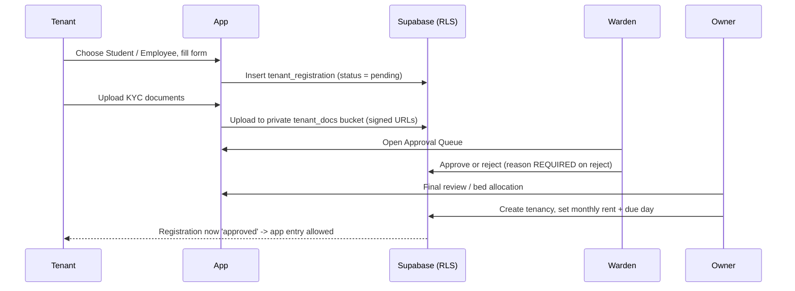
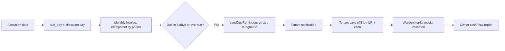
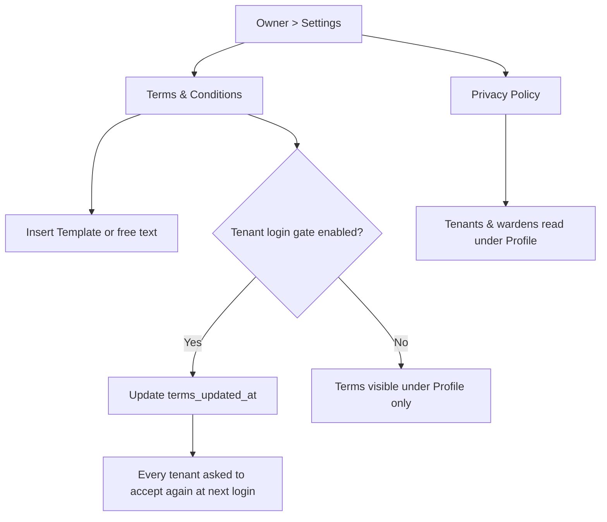

# Application flows

Diagrams use [Mermaid](https://mermaid.js.org/). They describe the implemented behaviour, not a wish list.

## 1. Sign-in and role routing

```mermaid
flowchart TD
    A[Open app] --> B{Saved session?}
    B -- Yes --> C[Load profile from Supabase]
    B -- No --> D[Welcome screen]
    D --> E[Email + password]
    E --> F{supabase.auth.signInWithPassword}
    F -- Error --> G[Show friendly error]
    F -- OK --> H[Profile active?]
    H -- No --> I[Block: account closed at checkout]
    H -- Yes --> J{Role = tenant?}
    J -- Yes --> K{Registration approved?}
    K -- No --> L[Block: pending / rejected / resubmit]
    K -- Yes --> M[Publish session + route to /]
    J -- No --> M
    C --> N[/app index: role + terms gate]
    M --> N
    N --> O{Role}
    O -- owner --> P[Owner portal]
    O -- warden --> Q[Warden portal]
    O -- tenant --> R{Terms accepted?}
    R -- No --> S[Terms & Conditions gate]
    S -- Accept --> T[Tenant portal]
    R -- Yes --> T
```

> The session is stored in SQLite via `expo-sqlite/localStorage/install`, so it survives app restarts. Auth-token refresh follows app foreground/background state.

## 2. Tenant registration and approval



## 3. Rent, dues and reminders



Tenants may change their due day **only before the 15th** of the month; after that the office must do it.

## 4. Checkout — archive first, then delete

```mermaid
flowchart TD
    A[Tenant: Profile > Initiate Checkout] --> B[Date + time + feedback form]
    B --> C[submit_checkout_request]
    C --> D{Existing pending request?}
    D -- Yes --> E[Blocked: one open request only]
    D -- No --> F[Owner reviews request]
    F -- Reject --> G[Mandatory reason -> tenant notified]
    F -- Approve --> H[decide_checkout(..., true)]
    H --> I[1. Archive into former_tenants]
    I --> J[2. Delete documents / invoices / registration / tenancy]
    J --> K[3. Delete auth login + profile]
    K --> L[Former-tenant record remains for owner]
```

The archive keeps name, address, phone, family contact and the tenant's feedback. Deletion is intentionally irreversible and is disclosed in the Terms before the tenant submits the form.

## 5. Privacy, Terms and the tenant gate



`terms_gate_enabled` is seeded **ON**. The Privacy Policy uses a built-in template until the owner publishes custom text; Terms are published by the owner and versioned by their update timestamp.

## 6. Data isolation

```mermaid
flowchart TB
    subgraph Client
      A[Expo app] | JWT |
    end
    subgraph Supabase
      B[GoTrue Auth] --> C[RLS policies]
      C --> D[(tenant data)]
      C --> E[(owner data)]
      C --> F[(tenant_docs private bucket)]
    end
    A --> B
    B --> C
    C -. tenant sees only own property .-> D
    C -. owner sees owned properties .-> E
    C -. signed 60s URLs .-> F
```
