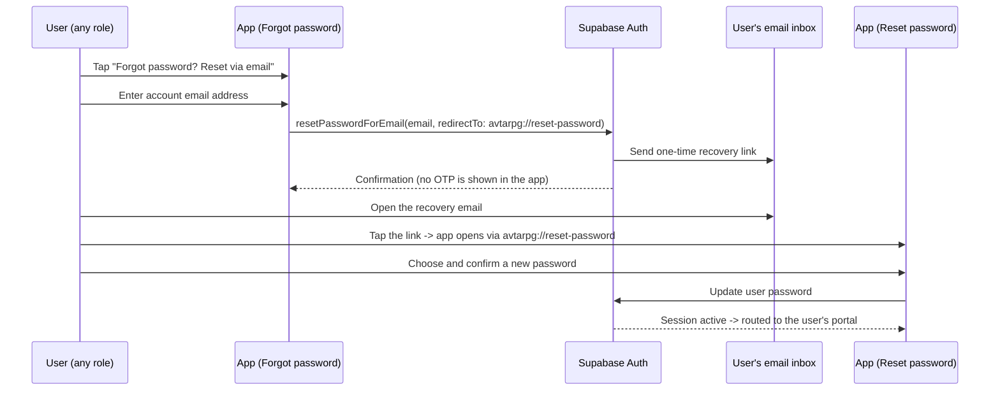

# Password recovery — email only

**Applies to:** every role (Tenant, Warden, Super Admin).
**Status:** implemented and verified against the live Supabase project (Nov 2026).

Password recovery in the AVTAR SINGH PG app is **email-only**. There is no SMS provider, no
phone-number OTP and no "demo mode" anywhere in the mobile app. A user enters the email address
on their account, Supabase sends a secure one-time recovery link, and opening that link on the
device brings up the app's new-password screen.

---

## How it works

The recovery link is **single-use and short-lived**. The email template only needs
`{{ .ConfirmationURL }}` — no numeric token is required, which is why no OTP entry screen
exists in the app.

**On the PWA** the same flow uses an HTTPS redirect instead of the custom scheme:
`https://<your-domain>/reset-password`. `supabase.auth` detects the tokens in the URL on web,
exchanges them for a session, and the reset screen appears inside the installed app or browser.
See [PWA_AND_VERCEL_DEPLOYMENT.md](PWA_AND_VERCEL_DEPLOYMENT.md) for the domain setup.

### Where the pieces live

| Piece | Location |
| --- | --- |
| "Send Recovery Link" screen | `app/(auth)/forgot-password.tsx` (chooses native vs web redirect) |
| New-password screen | `app/reset-password.tsx` |
| Supabase call | `sendPasswordResetEmail()` in `src/lib/supabase.ts` |
| Deep-link scheme (native) | `avtarpg` (`app.json`), redirect `avtarpg://reset-password` |
| Web redirect (PWA) | `${window.location.origin}/reset-password`, with `detectSessionInUrl: true` on web |

---

## One-time Supabase setup (already done on the live project)

1. **Auth providers:** Email enabled (`external_email_enabled = true`), email confirmation for
   sign-up off (`mailer_autoconfirm = true`).
2. **Redirect URL allowlist:** `Authentication → URL Configuration → Redirect URLs` must include
   `avtarpg://reset-password` (plus `exp://**` if testing in Expo Go). For the PWA also add
   `https://<your-vercel-domain>/reset-password` (and `http://localhost:3000/reset-password`
   for local testing). Without an allowlisted URL Supabase rejects the redirect.
3. **Site URL:** set to any valid URL (it does not need to host the app).
4. **Email delivery:** the built-in Supabase mailer is active. On the free tier with the default
   email provider the platform does **not** allow editing auth email templates — attempting to
   PATCH them returns `entitlement_required` / *"Email template modification is not available
   for free tier projects using the default email provider."* This is expected: the bundled
   recovery template already contains `{{ .ConfirmationURL }}`, so no custom template is needed.
   Customising the wording or sender requires a paid plan with custom SMTP, which is optional.

> Keep the email address on each profile current. Recovery links go only to that address;
> a typo means the user cannot reset their password. There is no phone fallback.

---

## What was removed (and why)

The original design used SMS OTP. That path has been retired from the shipped app:

- Removed from the UI: the SMS/OTP provider settings card, test-SMS button, OTP entry screen and
  all "get an OTP" labels.
- Removed from code: `requestPasswordOtp`, `resetPasswordWithOtp`, `getSmsStatus`, `sendTestSms`,
  `request_password_otp` / `reset_password_with_otp` RPC calls, and the SMS branch of the warden
  invite. Warden invites are now push, then email (`sendWardenInvite(email)`).
- No SMS vendor, API key, DLT registration or "demo mode" is required to use or deploy the app.

The historical database objects `password_reset_otps`, `sms_provider_config` and the OTP RPCs may
still exist from earlier migrations; the app does not call them. They are harmless and can be
dropped in a future cleanup migration.

---

## Troubleshooting

| Symptom | Cause | Fix |
| --- | --- | --- |
| "Enter the email address linked to your account" | Field empty or not a valid email | Type the exact email used at sign-in |
| "Could not send the recovery email" | Wrong Supabase config or rate limit | Check `.env` URL/key, then retry after the cooldown |
| No email arrives | Wrong address, spam folder, or mailer rate limit | Verify the profile email; check spam; wait and resend |
| Link opens a browser, not the app | Redirect URL not allowlisted or scheme not registered | Add `avtarpg://reset-password` in Supabase Auth and confirm `app.json` scheme |
| PWA reset link shows an empty screen | Web redirect not allowlisted | Add `https://<your-domain>/reset-password` to Supabase Auth redirect URLs |
| Link says invalid/expired | Link already used or too old | Request a fresh link from Forgot password |
| User cannot receive mail at all | No valid email on the account | Super Admin corrects the profile email in Supabase |

---

## Housekeeping

Never paste the service-role key into the app or `.env` — only the public anon/publishable key
ships. Management tokens used during setup are revoked after handover. See
[SECURITY_AND_LEGAL.md](SECURITY_AND_LEGAL.md).
